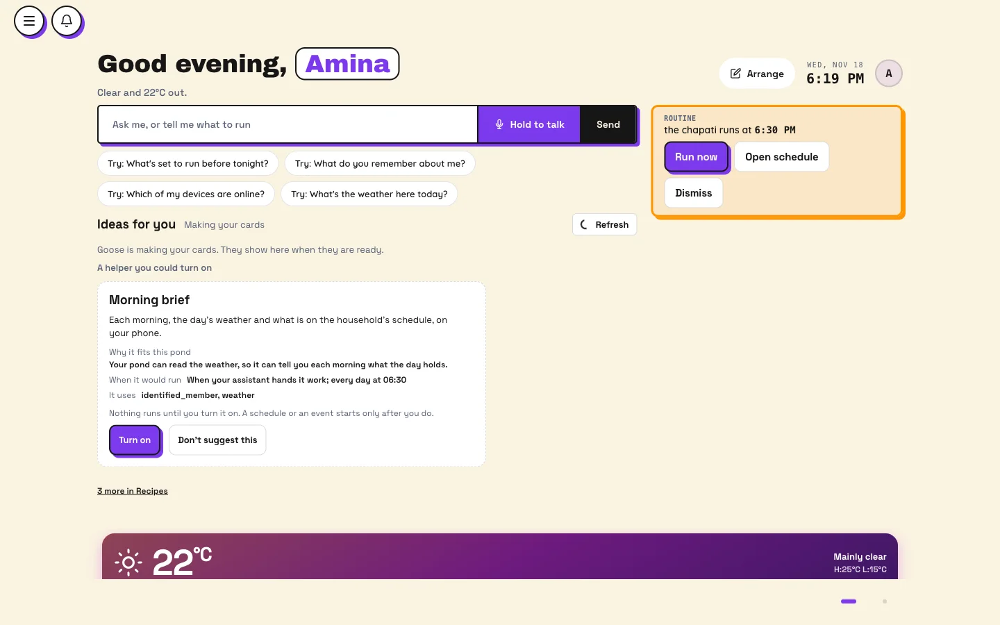
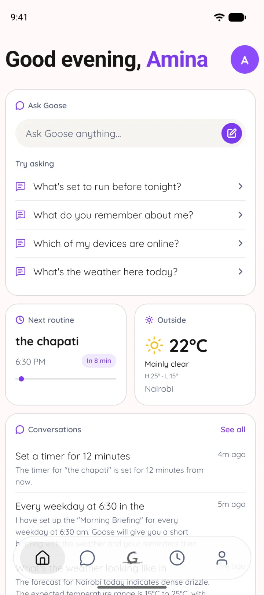
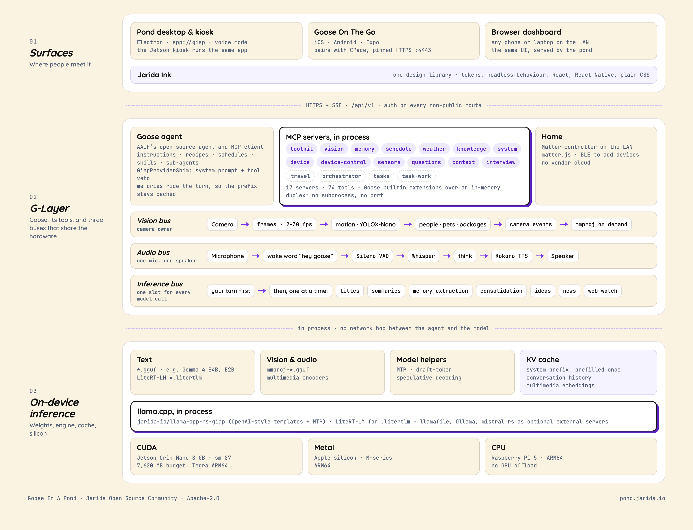

<div align="center">
  <picture>
    <source media="(prefers-color-scheme: dark)" srcset="pond-desktop/src/assets/goose-logo-dark.png">
    
  </picture>

  # Goose In A Pond

  **A household AI assistant that runs on hardware you own**

  Built on [goose](https://github.com/aaif-goose/goose) · Tools over [MCP](https://modelcontextprotocol.io) · Runs on a Jetson, a Mac or a Linux box · No cloud account

  [](https://aaif.io)
  [](./LICENSE)
  [](./docs/LICENSE-CC-BY-4.0)
  [](https://www.rust-lang.org)
  [](#getting-started)

  [Website](https://pond.jarida.io) · [Documentation](./docs/README.md) · [Quick start](./docs/QUICKSTART.md) · [Keynote](#talks)

</div>

<p align="center">
  <picture>
    <source media="(prefers-color-scheme: dark)" srcset="site/assets/shots/pond-home-dark.webp">
    
  </picture>
  
  <br>
  <sub>The pond's dashboard and Goose On The Go, current builds, on a demo household running Gemma 4 E4B.</sub>
</p>

---

## What is Goose In A Pond?

**Goose In A Pond (GIAP)** is a household assistant that lives on a small computer in your home.
Its main target is the **NVIDIA Jetson Orin Nano (8 GB)**; it also runs on macOS and Linux. The
model, speech, memory and every tool run on that device, and nothing needs a cloud account to work.

It is built on [goose](https://github.com/aaif-goose/goose), the open-source agent, pinned as the
`goose/` submodule. GIAP adds the household around it: voice in the room, memory of each member,
devices, schedules, a desktop app and kiosk, and a phone app, [Goose On The Go](#goose-on-the-go).
Every tool the assistant can call is an MCP server.

### What it does

| Capability | How |
|---|---|
| **Local models** | GGUF in process through llama.cpp by default, LiteRT-LM for `.litertlm` models, or an Ollama, llamafile or OpenAI-compatible server. The pond recommends models for its hardware and downloads them on first use |
| **Voice in the room** | The server runs the voice loop on the pond's own microphone and speaker: a "hey goose" wake word, Silero for the end of speech, Whisper in process, Kokoro to speak. Saying the wake word again interrupts the reply |
| **Tools** | GIAP's own MCP servers run in process as goose extensions: memory, schedules, weather, knowledge and web search, system, devices, sensors, vision and questions, with travel, context and orchestration off until switched on. A household can add any other MCP server |
| **Memory and personal context** | Memories extracted from conversations in the background, a fact sheet per member, and a local vector index over personal context, attached to each turn |
| **Devices** | Matter devices through a bundled matter.js controller; camera motion and face recognition as optional features |
| **Schedules and rules** | Cron or one-shot routines that run an agent prompt or a webhook, and rules that fire on a sensor, camera or device event |
| **Desktop app and kiosk** | An Electron app for macOS with a GUI mode and a voice mode; the Jetson runs the same app full screen on a touchscreen |
| **Phone app** | [Goose On The Go](#goose-on-the-go) pairs with a code or a printed setup card and talks to the pond over pinned HTTPS |
| **Remote access** | An embedded tailnet node (`native/pondnet`) reaches the pond away from home without an OS VPN |
| **Services** | Music (Apple Music, Spotify), calendar and mail (CalDAV, IMAP), rides (Uber), each on the household's own account |

---

## Goose On The Go

Goose On The Go is the pond's phone app for iOS and Android, built with Expo and React Native and
drawn with [Jarida Ink](https://github.com/jarida-io/ink). It pairs with a pond using CPace, a
password-authenticated key exchange: the six-digit code, a spoken code or the printed setup card is
the password, and it never crosses the network. From then on the phone talks HTTPS to a certificate
it pinned while pairing. It sets up a brand-new pond over Bluetooth, Wi-Fi details included,
reaches the pond away from home through its own tailnet node, and carries chat, schedules, the
household's memories and My Goose. On Android it can be the phone's assistant, woken with
"Hey Goose". See it on [pond.jarida.io](https://pond.jarida.io/#showcase).

---

## Architecture

<p align="center">
  
</p>

The code is hexagonal (ports and adapters). `pond-core` is the domain and imports no framework;
every adapter implements a trait (a port) defined there, and `pond-server` wires them together.

```
pond-server            binary: CLI, composition root, HTTP + HTTPS listeners, room voice
  pond-api             Axum router and DTOs; embeds the web dashboard
  pond-core            domain: ports, services and types, by bounded context
  pond-infra           SQLite: pond_system.db, pond_logs.db, pond_vectors.db
  pond-adapters-goose  the live agent engine (wraps goose)
  pond-mcp-server      GIAP's tools, as goose builtin MCP extensions
  pond-adapters-*      models, voice, devices, services, mesh
  pond-voice, pond-audio, pond-audio-out           microphone, text and speaker primitives
  pond-ear             wake word, endpointing, echo cancellation, Voice Match
  pond-net, pond-connect                             egress, setup channel, Wi-Fi
pond-desktop           Electron app (React + TypeScript), macOS and the Jetson kiosk
native/pondnet         Go: the embedded tailnet node and mobile bindings
matter-server          Node: the matter.js controller
site                   the pond.jarida.io landing page
```

Every crate is described in [docs/architecture/components.md](./docs/architecture/components.md),
and one chat turn is traced end to end in [docs/architecture/data_flow.md](./docs/architecture/data_flow.md).

---

## Getting Started

The short version, on a Mac or a Linux box:

```bash
git clone --recursive https://github.com/jarida-io/goose-in-a-pond.git
cd goose-in-a-pond
bash scripts/giap.sh install     # builds, sets up and downloads the models; -y skips the prompts
bash scripts/giap.sh doctor      # confirms the result; exits 1 on any FAIL
```

The rest of this section is what that does, and how to do each step by hand.

### 1. Prerequisites

- **Rust** stable via [rustup](https://rustup.rs). `giap.sh install` fetches it if it's missing.
- **Go ≥ 1.27**. The build compiles the bundled `pondnet` network helper (`native/pondnet`) next to `pond-server`. The installer does not install Go for you.
- **Node** `^22.13 || ^24 || >=26` for the desktop app and the tests (`.nvmrc` says 22). **≥ 20.19** is enough to build the web UI, and an older Node can still run the server. Not sure what you have? `bash scripts/giap.sh node` checks, uses one you already have (nvm, fnm, volta, asdf), or downloads one after asking. See [Node](docs/developer/installation.md#node).
- **Git** with submodule support (goose is vendored as the `goose` submodule)
- **cmake** and a C/C++ toolchain (`install.sh` installs these on Linux)

### 2. Install with `giap.sh`

**`scripts/giap.sh` is the front door.** Run it with no arguments for a menu that covers
install, build, service management, logs and diagnostics. It works out what the
host is (Jetson, generic Linux or macOS), checks whether CUDA actually works, and
looks for known bad states *before* you run into them. It only offers the actions
that make sense on that machine.

`install` puts guardrails in front of `scripts/install.sh`, which runs the full sequence:
preflight, submodule, system deps, build, `pond-server setup`, model downloads,
systemd, mDNS, verify. You can pick **Full** (the default) or **Minimal** (server + DB only, no model
downloads). It works out the mode itself (dev, production or Jetson) and won't add a
second systemd unit when one already exists.

Other non-interactive commands:

```bash
bash scripts/giap.sh build          # web UI, then pond-server + pondnet with this host's features
bash scripts/giap.sh build-ui       # web UI only
bash scripts/giap.sh build-desktop  # Electron app (macOS only)
bash scripts/giap.sh node           # find, or download and verify, the Node this repo needs
bash scripts/giap.sh status         # detection banner only
bash scripts/giap.sh logs           # today's rolling log file (not journald)
bash scripts/giap.sh check          # the CI checks for what your branch changes
bash scripts/giap.sh provision --host HOST --key FILE  # operator: give a Pond a device certificate
bash scripts/giap.sh --dry-run …    # print every command instead of running it
```

`make install|build|doctor` forward to the same script. `make deploy` runs
`scripts/jetson.sh deploy` directly, without the check `giap.sh deploy` adds, and
`make test` runs a subset of the cargo tests.

Run `doctor` after any install or deploy. Nothing else catches the failures
this project has historically shipped without any warning: a goose submodule the
parent commit did not move, a build without the CUDA feature that quietly runs on the CPU,
a placeholder dashboard the server itself cannot detect, two
service units competing for one port, and a stray `target/debug` binary that
`--native` prefers over your release build.

### 3. Building by hand

You don't need these if you use `giap.sh`, but these are the commands it runs:

```bash
# The genuinely fast set: no goose, no llama-cpp-2
cargo build -p pond-core -p pond-infra -p pond-api

# Build the web UI FIRST, or the server embeds a placeholder dashboard
(cd pond-desktop && npm ci && npm run build)

# pond-server pulls in goose AND llama-cpp-2 through its default features,
# so a cold build takes 10-35 minutes
cargo build -p pond-server --release

# The userspace network helper, placed next to the binary
bash scripts/build-network-helper.sh target/release
```

The server can't tell you when it has embedded the placeholder dashboard. Only
`giap.sh doctor` detects it.

### 4. First-time setup

`setup` initializes the databases, seeds the model catalog and prompt templates, and downloads the
Whisper ASR model. `install` already runs it, so you only need it after a hand build:

```bash
./target/release/pond-server setup                 # default: base (~74 MB)
./target/release/pond-server setup --model tiny    # ~39 MB, fastest
./target/release/pond-server setup --model small   # ~244 MB, most accurate

./target/release/pond-server onboard               # name, timezone, personality, model
```

### 5. Run the server

```bash
./target/release/pond-server serve --open          # HTTP + REST API + dashboard
./target/release/pond-server serve --port 4000 --https-port 4443 --debug
./target/release/pond-server serve --native        # also launch the desktop app (macOS)
```

The server opens two listeners:

- **HTTP** on `127.0.0.1` only (default port 4000). It serves the dashboard, the CLI and OAuth callbacks.
- **HTTPS** on all interfaces (default 4443). The paired phone app uses this one.

Each listener tries ten consecutive ports if its first choice is taken, so always
pass `--port` explicitly. To find the ports a server actually bound, read
`<data_dir>/.runtime_api_port` and `.runtime_https_port`.

The HTTP listener is loopback-only, so you can't reach the dashboard from another computer
at `http://<host>:4000`. Use an SSH tunnel with the same port on both ends, so
OAuth redirects registered against that port still land:

```bash
ssh -N -L 4000:127.0.0.1:4000 user@<host>
```

To pair a phone, use the dashboard or `pond-server pairing`. See
**[docs/remote-access.md](./docs/remote-access.md)** for remote (away-from-home) access.

### 6. Chat from the terminal

```bash
./target/release/pond-server chat                       # text mode (keyboard)
./target/release/pond-server chat --provider ollama -M llama3.2
./target/release/pond-server chat --provider llamafile  # llamafile on :8080
./target/release/pond-server chat --voice               # wake word → listen → reply aloud
```

`--voice` downloads whatever it's missing on the first run. You don't need to install anything first.

### 7. Run as a service (Linux)

```bash
bash scripts/giap.sh             # menu 20 installs a user systemd unit (21–24 start/stop/restart/remove)
```

This installs a **user** unit and runs `loginctl enable-linger`, so the service survives
logout and starts at boot. `scripts/install.sh` writes a *system* unit with the
same name. If both exist, you get two servers, each loading its own model into the same
memory. `giap.sh` refuses to create the second one. The service logs to rolling files
under the data directory, not to journald.

### 8. Jetson Orin Nano

Deploy from your dev machine. The Jetson's Node is too old to build the UI, so the UI
is built locally and synced, and the CUDA build runs on the device (~35 min from clean):

```bash
bash scripts/giap.sh deploy      # wraps scripts/jetson.sh deploy with a safety check
```

Two things to watch for. First, the deploy **hard-resets the device** to `origin/<branch>`.
Second, the device's `origin` is your personal fork, so if you push only to the org remote,
the deploy builds stale code and still reports success. `giap.sh deploy` refuses unless HEAD is
on both. After a deploy the service listens on 8080, not 4000, so tunnel that port:
`ssh -N -L 8080:127.0.0.1:8080 user@<host>`, then open `http://localhost:8080`. See
**[scripts/jetson/README.md](./scripts/jetson/README.md)** and
**[docs/developer/jetson-dev-routine.md](./docs/developer/jetson-dev-routine.md)**.

No Jetson on your desk? `bash scripts/jetson-emu.sh run` makes the Orin's decisions on a Mac, such
as the context size it picks for its memory budget, though never its performance.

### 9. Desktop app (macOS)

```bash
cd pond-desktop
npm install
npm run dev:electron             # dev: Vite + Electron, starts pond-server for you
npm run bundle:app               # release .app (or: bash scripts/giap.sh build-desktop)
```

The desktop app has two modes: the GUI and the voice screen.
On Linux there's no packaged desktop app. Use the server's own dashboard instead.

---

## Voice

`serve` runs the voice loop itself on the pond's own microphone and speaker wherever the models,
a microphone and a speaker are there; `GET /api/v1/voice/room` says whether it is running, and the
`voice_room_enabled` setting switches it. To try voice from a terminal instead:

```bash
./target/release/pond-server chat --voice                  # wake word, listen, reply aloud
./target/release/pond-server chat --voice --no-wake-word   # listen on every turn
```

The first run downloads whichever voice models are missing. Recognition runs in process through
whisper-rs (Metal on macOS, CUDA on the Jetson); speech is Kokoro. Only one voice loop holds the
microphone at a time. The desktop app attaches to the room's voice where it is running, and
otherwise starts `chat --voice --json-events` as a child process and drives its voice screen from
the events. [docs/developer/voice-mode.md](./docs/developer/voice-mode.md) has the whole stack.

---

## Everyday commands

```bash
pond-server agent chat "what is the weather?"   # one turn through the agent, no voice
pond-server agent tools                         # MCP tools the agent can see
pond-server models list                         # the model catalogue
pond-server prompts list | show NAME | reset NAME
pond-server skills list | add NAME --content TEXT | toggle ID | remove ID
pond-server memories list | add TEXT | remove ID
pond-server pairing                             # pairing code and QR for the phone
pond-server setup-code                          # the printed setup card
pond-server dashboard                           # a sign-in link for the web dashboard
pond-server status
```

Every command and flag is in [docs/cli.md](./docs/cli.md).

---

## Testing

```bash
bash scripts/giap.sh check                  # the CI checks for what your branch changes (--all)
make test                                   # a quick subset: pond-core, pond-api, pond-infra
cargo test -p pond-core <name>              # one test
cargo test -p <crate> -- --ignored          # live tests that need hardware, models or keys
cargo check -p pond-server -p pond-adapters-goose --all-targets   # the production binary
scripts/live-test.sh                        # the real server over HTTP, restarts included
cd pond-desktop && npm test && npm run typecheck && npx playwright test
```

Unit tests never exercise startup ordering, migrations against a database that already has rows,
or auth middleware; `scripts/live-test.sh` does, and is required for any change to a migration,
route, handler or startup code. See the [testing guide](./docs/testing/tdd_guide.md) and
[CONTRIBUTING § Checks](./docs/CONTRIBUTING.md#checks), which mirrors
[`.github/workflows/ci.yml`](./.github/workflows/ci.yml).

---

## Tech stack

| Layer | Technology |
|---|---|
| Core | Rust (`rust-version` 1.91.1) |
| Agent | [goose](https://github.com/aaif-goose/goose), MCP via `rmcp` |
| HTTP | Axum 0.8, rustls |
| Storage | SQLite via SQLx (three databases) |
| Local inference | llama.cpp (in process through `llama-cpp-2`), LiteRT-LM |
| Speech | whisper-rs, Silero VAD, Kokoro |
| Desktop | Electron, React 19, TypeScript, Vite, HeroUI, [Jarida Ink](https://github.com/jarida-io/ink) |
| Phone | [Goose On The Go](#goose-on-the-go): Expo, React Native |
| Networking | Go (`native/pondnet`): tsnet against a Headscale coordinator |
| Devices | matter.js (`matter-server/`) |
| Tests | cargo test, Vitest, Playwright, `scripts/live-test.sh` |

---

## Documentation

Start at the **[documentation index](./docs/README.md)**. The most used pages:

| Document | For |
|---|---|
| [Quick start](./docs/QUICKSTART.md) | A first change, checked as CI checks it, in about ten minutes |
| [Installation](./docs/developer/installation.md) | What `giap.sh install` does, prerequisites, troubleshooting |
| [Components](./docs/architecture/components.md) | Every crate and what it owns |
| [Data flow](./docs/architecture/data_flow.md) | One chat turn from request to response |
| [CLI](./docs/cli.md) and [REST API](./docs/api.md) | Reference |
| [Remote access](./docs/remote-access.md) | Reaching the pond away from home |
| [Design](./DESIGN.md) | The design rules for every surface |
| [Contributing](./docs/CONTRIBUTING.md) | Branches, commits, comments, tests |
| [AGENTS.md](./AGENTS.md) and [HOWTOAI.md](./HOWTOAI.md) | For coding agents: how GIAP fits together, and the traps |

---

## Talks

**Democratizing AI with Goose In A Pond**, a 15-minute keynote at the MCP conference: why a
household assistant belongs on a box in the house, and how MCP, goose and a local model make one.
The [slides](https://pond.jarida.io/assets/democratizing-ai-with-goose-in-a-pond.pdf) are on
[pond.jarida.io](https://pond.jarida.io/#keynote); the architecture diagram, and the source in
the code of every figure on the slides, are in [docs/keynote](./docs/keynote/README.md).

---

## Contributing

Contributions are welcome from Rust developers, embedded systems engineers, AI/ML researchers, mobile
developers and technical writers. New here? The [quick start](./docs/QUICKSTART.md) gets you to a
first checked change in about ten minutes. Read the [Contributing Guide](./docs/CONTRIBUTING.md), then:

1. Fork the repo and clone it with `--recursive`.
2. Branch: `git checkout -b feat/your-feature`.
3. Keep the hexagonal split: new capabilities go through a port in `pond-core`.
4. Write the tests first against the port's mock (`cargo test -p pond-core`).
5. Run `bash scripts/giap.sh check`: the checks CI runs, for what your branch changes.
6. Open a pull request.

---

## A friend of the AAIF

Goose In A Pond is a friend of the [Agentic AI Foundation (AAIF)](https://aaif.io). It is built on
the foundation's projects: [goose](https://github.com/aaif-goose/goose) runs every turn, every tool
is a [Model Context Protocol](https://modelcontextprotocol.io) server, and coding agents working in
this repository start at its [AGENTS.md](./AGENTS.md). GIAP is an independent project; the AAIF
does not host it. GIAP builds goose from a tracked fork that syncs with upstream; the patches it
carries, and which are fit to send upstream, are in
[goose patch management](./docs/goose-patch-management.md).

---

## Sponsor

<table>
  <tr>
    <td align="center" width="260">
      <a href="https://spiral.xyz"><strong>spiral.xyz</strong></a>
      <br/>
      <sub>A Block initiative for the public good, funding open-source bitcoin and AI</sub>
    </td>
  </tr>
</table>

Goose In A Pond is sponsored by [spiral.xyz](https://spiral.xyz). Interested in supporting the
project? Write to [info@jarida.io](mailto:info@jarida.io).

---

## License

Goose In A Pond is dual-licensed:

- **[Apache License 2.0](./LICENSE)** for the source code
- **[CC BY 4.0](./docs/LICENSE-CC-BY-4.0)** for documentation and media

You may use, modify and distribute this project, including commercially, provided you comply with the license terms.

**Attribution:**
```
This product includes software developed by the Goose In A Pond contributors
and licensed under the Apache License, Version 2.0 and CC BY 4.0.
```

---

<div align="center">
  <a href="https://jarida.io"></a>
  <br/>
  <sub>Built by the <a href="https://jarida.io">Jarida Open Source Community</a> · Nairobi, Kenya</sub>
</div>
